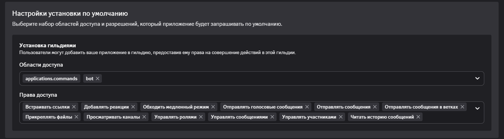

# Gravekeeper Discord Bot

Бот на Golang для мониторинга Discord каналов. Наказывает пользователей мутом за упоминание "dead chat" (и аналогов) и отправляет настраиваемую цепочку ответов (Текст и/или Голосовое сообщение и/или Гифка).

> [!warning] 
> Сгенерировано Gemini Pro 3.1, доработано человеком

## 📂 Структура проекта
```text
.
├── data/               # Папка для сохранения стейта (mutes.json)
├── audio.ogg           # Ваше голосовое сообщение (формат OGG Opus)
├── config.yaml         # Конфигурация бота
├── docker-compose.yml  # Compose-файл для запуска
├── Dockerfile          # Инструкция сборки образа
├── go.mod              # Модули Go
└── main.go             # Исходный код
```

## 🛠 Предварительная подготовка

1. **Создайте бота в Discord**
   - Перейдите в [Discord Developer Portal](https://discord.com/developers/applications).
   - Создайте приложение -> Перейдите во вкладку `Bot`.
   - Выставить права в меню "Установка"
     
   - **ВАЖНО:** Включите галочку **Message Content Intent** (меню "Бот" - раздел `Privileged Gateway Intents`). Без нее бот не сможет читать тексты сообщений.
   - Скопируйте `Token` бота (Меню "Бот" - "Токен")

2. **Подготовьте аудиофайл (`audio.ogg`)**
   Discord принимает голосовые сообщения **строго в формате `.ogg` с кодеком `Opus`**. Обычное переименование `.mp3` не сработает!
   Конвертировать можно с помощью `ffmpeg`:
   ```bash
   ffmpeg -i audio.mp3 -c:a libopus -b:a 64k audio.ogg
   ```

3. **Создайте папку `data`**
   Она нужна для сохранения списка мутов (чтобы при рестарте бота таймеры восстанавливались).
   ```bash
   mkdir data
   ```

## ⚙️ Настройка (`config.yaml`)

Скопировать `example.config.yaml` и назвать его `config.yaml`

Откройте `config.yaml` и заполните:
- `bot_token`: Токен вашего бота.
- `guild_id`: ID вашего сервера (Включите "Режим разработчика" в Discord -> ПКМ по серверу -> Копировать ID сервера).
- `monitored_channels`: Список ID каналов для мониторинга.
- `mute_role_id`: ID роли, которая отбирает права писать в чат.
- `mute_duration`: Время мута (например `5m`, `1h`).

В блоке `responses` вы можете настроить **порядок и количество** отправляемых сообщений (бот отправляет их сверху вниз). Поддерживаются `text`, `gif` и `voice`.

## 🚀 Запуск через Docker (Рекомендуется)

Убедитесь, что у вас установлен Docker и Docker Compose.

1. Инициализируйте зависимости (один раз на хосте, чтобы создать `go.sum`, если у вас установлен Go, или просто пропустите и соберите образ):
   ```bash
   go mod init gravekeeper-bot
   go get github.com/bwmarrin/discordgo
   go get gopkg.in/yaml.v3
   ```
2. Соберите и запустите контейнер в фоновом режиме:
   ```bash
   docker compose up -d --build
   ```

3. Посмотреть логи бота:
   ```bash
   docker compose logs -f
   ```

## 🛑 Остановка и обновление
- Остановить бота: `docker compose down`
- Если вы изменили `config.yaml`, просто перезапустите контейнер: `docker compose restart`
